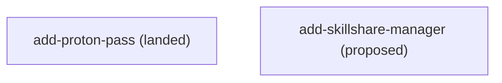

# Roadmap

Cross-change order for this image. Edges are owned by change front-matter (`depends_on`) and
rendered into the block at the bottom of this file; the prose above it is the narrative and one
line per active change, not the source of truth.

## Tracks

- `docs/changes/add-skillshare-manager/` — (proposed) Skillshare as the image-managed skill service.
- `docs/changes/archive/2026-10-22-add-proton-pass/` — (landed) Proton Pass desktop app and CLI from Proton's official channel.

- **Image feature work** lands as `docs/changes/<name>/` folders; landed ones move to
  `docs/changes/archive/<date>-<name>/` (landing owns that move).
- **Reference/backlog** lives in `docs/hardware-notes.md` (frozen), `docs/layer-optimization.md`
  (frozen), and `docs/self-build-todo.md` (deferred register).

<!-- BEGIN GENERATED DAG (regenerate: doc-contract update --repo-root .) -->

<!-- END GENERATED DAG -->
