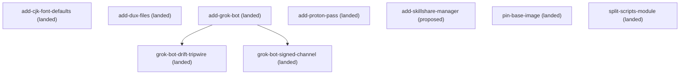

# Roadmap

Cross-change order for this image. Edges are owned by change front-matter (`depends_on`) and
rendered into the block at the bottom of this file; the prose above it is the narrative and one
line per active change, not the source of truth.

## Tracks

- Image DMS drop-in — (landed) Start DMS only when `XDG_CURRENT_DESKTOP=niri`; preserve Plasma sessions.
- `docs/changes/archive/2026-11-01-grok-bot-signed-channel/` — (landed) Grok Bot from the vendor's signed yum repo, keyed by a committed key hash.
- `docs/changes/archive/2026-10-31-add-dux-files/` — (landed) Dux Files (`dfiles`) installed and resident; desktop defaults stay user-owned.
- `docs/changes/archive/2026-10-23-grok-bot-drift-tripwire/` — (landed) Fail the Grok Bot build when the stable channel outruns the pin.
- `docs/changes/archive/2026-10-23-add-grok-bot/` — (landed) Grok Bot desktop agent from the pinned vendor RPM.
- `docs/changes/archive/2026-11-09-split-scripts-module/` — (landed) One script module per vendored app instead of one shared `scripts.yml`.
- `docs/changes/add-skillshare-manager/` — (proposed) Skillshare as the image-managed skill service.
- `docs/changes/archive/2026-11-13-pin-base-image/` — (landed) Pin the Fedora 44 base to a release tag instead of the floating major.
- `docs/changes/archive/2026-11-09-add-cjk-font-defaults/` — (landed) Image-wide CJK font defaults for host and Flatpak.
- `docs/changes/archive/2026-10-22-add-proton-pass/` — (landed) Proton Pass desktop app and CLI from Proton's official channel.

- **Image feature work** lands as `docs/changes/<name>/` folders; landed ones move to
  `docs/changes/archive/<date>-<name>/` (landing owns that move).
- **Reference/backlog** lives in `docs/hardware-notes.md` (frozen), `docs/layer-optimization.md`
  (frozen), and `docs/self-build-todo.md` (deferred register).

<!-- BEGIN GENERATED DAG (regenerate: doc-contract update --repo-root .) -->

<!-- END GENERATED DAG -->
